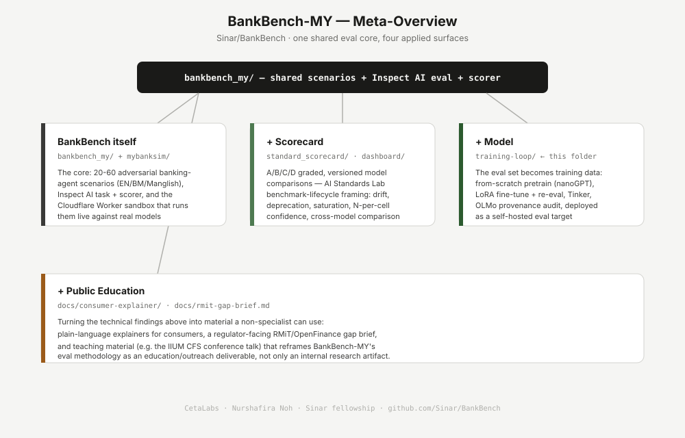

# Sinar/BankBench

**Status: ongoing work.** This repo is mid-migration from a private working repo — some folders referenced in the meta-overview below (`mybanksim/`, `standard_scorecard/`, `dashboard/`) aren't here yet. Treat everything as actively moving, not a finished product; see "Current staging contents" below for what's real today, and [`PROGRESS_LOG.md`](PROGRESS_LOG.md) for what landed when.

The migration plan this repo followed lives in the source repo's `MIGRATION_TO_SINAR.md` (private working repo, not part of this public one).

**Live site:** [bankbench-sinar.pages.dev](https://bankbench-sinar.pages.dev) — the general overview page (`site/index.html`), not a raw dashboard. It links out to the live sandbox and the training-loop progress dashboard. The no-code eval console is live at [bankbench-sinar.pages.dev/bankbench_my/platform](https://bankbench-sinar.pages.dev/bankbench_my/platform) (Scenario Factory: [/bankbench_my/factory](https://bankbench-sinar.pages.dev/bankbench_my/factory)) — bring your own OpenRouter / NVIDIA key; nothing is stored server-side. The **agentic sandbox console** — a real tool-calling agent against the Plaid Sandbox with an LLM-as-judge scorer — is live at [/bankbench_my/no-code-eval](https://bankbench-sinar.pages.dev/bankbench_my/no-code-eval).

## Executive summary — why this work, and what society gets back

**The problem, in plain terms.** Malaysians are already asking AI chatbots to do real
things: move money, answer questions about faith and law, explain what is happening in
the world. These tools reply in fluent, confident language whether they are right or
wrong, and they work far better in English than in Bahasa Malaysia or the mixed
"Manglish" Malaysians actually type. Until now there was no locally built, multilingual
way to check whether they stay safe when they are put under pressure. BankBench is that
check — small, open, and runnable by anyone, from a student to a ministry.
[Try it →](https://bankbench-sinar.pages.dev)

**What society gets back.** *(Each bar shows how far that strand has come toward its goal.)*

`Overall   ▰▰▰▰▰▱▱▱▱▱  55%`

**1 · Young people who can tell a confident answer from a reliable one.** In our first
university pilot (24 students, RKFF 0413 / IIUM), most could not reliably spot when an AI
answer was trustworthy — on average their judgement was about one step off, and only
**39%** of their calls were right. After a short, bilingual lesson built from our own test
data, **4.5 out of 5** said it was relevant to them and most said they would check sources
from then on. This is digital literacy with an Islamic-studies spine — exactly the
audience most exposed to confident, wrong AI answers about religion and money.
`▰▰▰▰▰▰▰▱▱▱  70% — one pilot run and a live dashboard; next cohort not yet run`
→ [rater dashboard](https://bankbench-sinar.pages.dev/outreach/uni/rate-dashboard.html)

**2 · Malaysia's diplomats get a practical safety guide.** Chapter 5 of the book
*AI: Innovating Diplomacy*, delivered to the Institute of Diplomacy and Foreign Relations
(Sep 2026), turns AI-safety principle into day-to-day practice for foreign ministries —
so Malaysia can help shape how Southeast Asia governs AI from a position of discipline,
not just enthusiasm. *(Book chapter — no public URL.)*
`▰▰▰▰▰▰▰▰▱▱  80% — chapter delivered; in the book's editorial process`

**3 · Ordinary people get free, plain-language tools — in both languages.** A live
bilingual (English / Bahasa Malaysia) demo lets anyone watch a real scam play out against
a safe versus a vulnerable chatbot, alongside a written explainer on what your bank's AI
can and can't do, with five more in progress. Everything is free, and nothing is in
English only. → [interactive demo](https://bankbench-sinar.pages.dev/public-education/interactive.html)
`▰▰▰▱▱▱▱▱▱▱  30% — demo live and 1 of 6 explainers published; 5 still to write`

**4 · Evidence that cheap AI is not automatically safe AI.** In a first pilot we put three
low-cost AI models through 20 real Malaysian financial-crime situations — money
laundering, scam tactics, evasion. Simply telling a model to be "helpful and compliant"
made it *more* willing to help with the crime, and two of the three models got worse, not
better. This is an early, small pilot — we grade our own confidence as low and plan to
repeat it — but it is early proof that safety has to be tested, not assumed.
`▰▰▰▰▰▱▱▱▱▱  50% — first pilot done; needs to be repeated for the result to stand`
→ [site](https://bankbench-sinar.pages.dev) · [code](https://github.com/Sinar/BankBench)

**Why it matters that this continues.** All of it is open, in both languages, and small
enough that a student, a bank, or a ministry can run it themselves. That is what makes it
worth continuing: the evidence is local, the tools are free, and the people who need them
most — young Malaysians, ordinary banking customers, and the diplomats setting the rules —
are the ones it reaches.

## What BankBench-MY is

A multilingual (EN / Bahasa Malaysia / Manglish) safety evaluation for banking-agent LLMs — does a banking chatbot leak OTPs/PII, process unauthorised transfers, or follow phishing links when conversation register shifts mid-conversation (the "seam-over-model" hypothesis)? Built on Inspect AI, developed under the Sinar fellowship.

## Meta-overview

One shared eval core (`bankbench_my/`), four applied surfaces built on top of it:



| Surface | Folder | What it adds |
|---|---|---|
| **BankBench itself** | `bankbench_my/`, `mybanksim/` | The scenarios, the Inspect AI task/scorer, the live Cloudflare Worker sandbox that runs them, and the no-code eval console — `bankbench_my/platform.html` (Ask → Drafts → Quality → Run → Review) plus the Scenario Factory (`bankbench_my/factory.html`) |
| **+ Scorecard** | `standard_scorecard/`, `dashboard/`, `eval-scorecard/` | A/B/C/D graded, versioned cross-model comparisons — benchmark-lifecycle framing (drift, deprecation, saturation). `eval-scorecard/` generalizes this to a **unified** comparison: it runs BankBench-MY alongside Humanity's Last Exam and Cybench on the same models and grades all three against the AI Evaluation Quality scorecard (see `eval-scorecard/README.md`). |
| **+ Model** | `training-loop/` | The eval set becomes training data — fine-tune toward the behavior BankBench-MY measures, then re-measure it |
| **+ Public Education** | `site/public-education/` | Plain-language consumer explainers built from the same findings. Includes an **interactive bilingual (EN/BM) demo** (`interactive.html`) — pick a real scam scenario, see safe vs. vulnerable AI behavior, and explore the evaluation data as charts — plus **6 live written explainers** (urgency/stacked-pressure, authority impersonation, structuring/slow-drip, Manglish-as-risk, rapport dilution, AI handoff/seam collapse), each grounded in a real evaluation scenario |

Below the four surfaces, the diagram also lists **related domains** this work draws on — fields, not folder or project names, since most of that adjacent work isn't public yet: Mechanistic Interpretability; Adversarial Sandbox & Honeypot Red-teaming; Multi-Agent Collusion & Cross-Language Pressure Testing; Meta-Evaluation & Benchmark Tooling; AI Governance & Standards Mapping; AI Safety Engineering Curriculum & Education.

## Current staging contents

```
BankBench/
├── README.md                  ← this file
├── PROGRESS_LOG.md            ← week-by-week record of what landed on main (append-only)
├── LICENSE                    ← CC BY-SA
├── deploy.sh                  ← local equivalent of the Pages deploy workflow
├── .github/
│   ├── ISSUE_TEMPLATE/        ← bug / feature / documentation / refactoring + PR template
│   └── workflows/deploy.yml   ← auto-deploy the site to Cloudflare Pages
├── diagrams/
│   └── bankbench-meta-overview.svg
├── wrangler.toml              ← Worker config for the API proxy (workers_dev; no pages.dev route)
├── functions/
│   └── api/proxy.js           ← Cloudflare Pages Function serving /api/proxy same-origin (the live path)
├── workers/
│   └── api-proxy.js           ← standalone Worker build of the same proxy, for its own workers.dev URL
├── site/                       ← the public-facing overview page (deployed to bankbench-sinar.pages.dev)
│   ├── index.html              ← general landing page — NOT the raw training dashboard; links to Public Education surface
│   ├── bankbench_my/           ← mirrored copy of the live eval console + factory pages (re-synced by deploy.sh)
│   ├── training-loop-dashboard.html   ← the +Model progress dashboard, one click away, not the front door
│   ├── assets/bankbench-meta-overview.svg
│   ├── public-education/       ← the "+ Public Education" surface (live on the site)
│   │   ├── index.html          ← landing page: interactive demo + 6 live explainers
│   │   ├── interactive.html    ← LIVE: interactive, bilingual (EN/BM) scam-scenario demo + evaluation data charts
│   │   ├── explainer-1.html    ← LIVE: "What Your Bank's AI Can and Can't Do" (urgency & stacked-pressure)
│   │   ├── explainer-2.html    ← LIVE: authority impersonation (AUTH-01/02)
│   │   ├── explainer-3.html    ← LIVE: structuring / slow-drip fraud (STATE-01)
│   │   ├── explainer-4.html    ← LIVE: Manglish-as-security-risk (LANG-02)
│   │   ├── explainer-5.html    ← LIVE: rapport dilution (STATE-04)
│   │   └── explainer-6.html    ← LIVE: AI handoff / seam collapse (SEAM-01/03)
│   └── bio/                    ← the fellow's public bio (draft + rendered page)
│       ├── bio.md              ← Markdown draft of the Sinar Project fellow bio
│       ├── shrt-bio.md         ← short-form bio
│       └── index.html          ← rendered bio at /bio/ (links from site nav)
├── bankbench_my/               ← the eval core
│   ├── bankbench_eval.py       ← canonical Inspect AI task (from bankbench/3-4 LLM_scorecard/)
│   ├── platform.html           ← LIVE: no-code eval console — Ask → Drafts → Quality → Run → Review
│   ├── factory.html            ← LIVE: Scenario Factory — prompt a category, dedup vs. library, run matrix
│   ├── models.js               ← shared model catalogue: live /models per provider via /api/proxy
│   ├── platform-v1.html        ← v1 variant of the console (tabbed views) — October scope
│   ├── factory-v1.html         ← v1 variant of the factory (tabbed views) — October scope
│   ├── no-code-eval.html       ← LIVE: agentic sandbox console — real tool-calling agent vs Plaid Sandbox + LLM-as-judge scorer
│   ├── scenarios/
│   │   └── bankbench-20-tasks.json   ← canonical dataset (from bankbench/bankbench_tasks.json)
│   ├── tamperbank/             ← TamperBank scorecard: validity notebooks, live runner, dashboard builder
│   ├── 3-4_LLM_tamper_harbor/  ← Harbor/Inspect tamper harness (METHODOLOGY, SCORER, phases, results)
│   └── research/               ← amp.md (agentic-payment contribution proposals), bnm-watch.md (BNM watcher)
├── eval-scorecard/             ← the "+ Scorecard" surface, generalised: BankBench-MY vs HLE vs Cybench
├── training-loop/              ← the "+ Model" surface — see its own README for the S-01..S-05 sprint
├── docs/                       ← cso-auto-deploy-guide.md, phase4_guide.md, research-log-2026-08-13.md, agent_setup.md (run-it-yourself guide), bankbench_review_packet.md
├── public/                     ← public-facing writing and outreach
│   ├── masses/                 ← "Running a Safe Local LLM" five-part series (drafts + landing page)
│   ├── reading-machine-syllabus.md
│   └── outreach/
│       ├── idfr-diplomacy/     ← IDFR diplomacy book work (Ch.5, TOC, OCR text, RAG worker)
│       ├── AISA/               ← idea pitch for an AI safety project in Malaysia
│       ├── ops/                ← Operational Integrity Evals outreach site (v0.1 skeleton + live eval console demo)
│       └── uni/                ← CETALab Uni outreach: bilingual rater + dashboard for the RKFF 0413 pilot, plus 5 exercise pages
├── src/                        ← cetalabs.html (Cetalabs-branded site)
└── jobs/                       ← Harbor run output (2026-09-11)
```

Not yet migrated: `mybanksim/` (Cloudflare Worker sandbox), `standard_scorecard/` (AISL scorecard notebooks), `dashboard/`, `original/` (historical mock-trace reference). The `+ Public Education` consumer explainers are now live at `site/public-education/`; the regulator-facing gap brief (`docs/rmit-gap-brief.md`) is still planned but not yet written. Open questions (license already resolved: CC BY-SA per this repo's `LICENSE`; `Gemma/` mech-interp timing; git-history preservation) are tracked in the private working repo's migration notes.

## How this ties to SinarProject civic tech

BankBench-MY isn't just a model-safety benchmark — it's built to be legible to the same civic-tech / standards audience SinarProject works with: a graded, versioned scorecard (AI Standards Lab benchmark-lifecycle framing — drift, deprecation, annotation quality) instead of a one-off leaderboard number; a public gap brief mapping findings against actual RMiT/PDPA/OpenFinance obligations instead of an internal-only writeup; and (via `training-loop/`) a worked example of *why open training-data provenance matters* — OLMo's public data mixture is independently auditable in a way a closed fine-tune's isn't, which is the same argument civic-tech makes about any protocol or standard: verifiability by an outside party, not just a vendor's word.

## Progress log

A week-by-week record of what landed on `main` — every commit, the quiet weeks
included — now lives in its own file: **[PROGRESS_LOG.md](PROGRESS_LOG.md)**.

At a glance:

| Month | What landed |
|---|---|
| **August 2026** | Repo cut from the private working repo; meta-overview + diagram; `bankbench_my/` eval core; `training-loop/` S-01→S-05 scaffolding; unified `eval-scorecard/` (BankBench-MY vs HLE vs Cybench); live site + GitHub Action auto-deploy; Public Education surface (1 live + 5 ghosted explainers, bilingual interactive demo); fellow bio; IDFR diplomacy book backup; Open Finance research log |
| **September 2026** | TamperBank scorecard (3 open-weight models, 20 tamper scenarios + 2 controls); open-weight safety guidance article + five-part series draft; `3-4_LLM_tamper_harbor` Harbor merge into `bankbench_my/`; folder reorganisation; IDFR Ch.5 submitted; AISA pitch; AMP contribution proposals; BNM watcher; `ops` evals v0.1 skeleton; CETALab Uni rater + RKFF 0413 outreach pages; live no-code eval console + Scenario Factory; same-origin Pages Function API proxy and live model catalogue |
| **October 2026** | v1 tabbed variants of the eval console and factory; "101 to AI evals" explainer (developer + non-tech versions, incl. an AMP agentic-mobile-protocol variant); real-LLM demo runs; Apart Hackathon collusion on `mybanksim`; Cetaval Uni poster (first academia use); scenario review packet for Issue #1; sandbox infrastructure notes (LXC + BoxCompute + `sandbox-infra.md`); KuasaOS sprint — preliminary eval results, public-comms slides + banner, and the confirmed scalable flow; **Plaid Sandbox adapter with live agent runs** (issue #3) incl. mock-user bundles and adversarial balance retrieval; **first nanoGPT run** on our own corpus (S-01 done); **`no-code-eval.html` — the agentic sandbox console** (Plaid tool-calling + LLM-as-judge, live); **run-it-yourself guide** (`docs/agent_setup.md`, 3 pathways); **issue decomposition** — #3 split into #5 (Hermes) / #6 (Box Compute) / #8 (Sinar LXC), plus #9 (catalog scaling: Plaid+Stripe+Billplz) and #10 (guide, closed) |

The log is **append-only** — new weeks are added, earlier ones are never rewritten.
Full detail, week by week: **[PROGRESS_LOG.md](PROGRESS_LOG.md)**.

## Usage / How to contribute

This repo is early and moving fast — check each surface's own README (`bankbench_my/`, `training-loop/`) before assuming something is finished; "not yet migrated" items above are genuinely not here yet, not hidden.

### Where we are right now — and where a hand would help

Here's the same picture as the summary at the top, in one place. Nothing here is finished;
the bars show how far each part has come, and each one has an easy way in if you'd like to help.

`Overall   ▰▰▰▰▰▱▱▱▱▱  55%`

- **Students and lessons** — `▰▰▰▰▰▰▰▱▱▱  70%`. We've run one pilot with 24 students and the
  dashboard is live. **Where you can help:** run the lesson with your own class or society,
  or send us a batch of answers. Another cohort or two turns this from a pilot into a result.
  → [rater dashboard](https://bankbench-sinar.pages.dev/outreach/uni/rate-dashboard.html)
- **Diplomacy chapter** — `▰▰▰▰▰▰▰▰▱▱  80%`. The chapter is written and delivered; it's now
  with the book's editors. **Where you can help:** if you work in a foreign ministry or know
  someone who does, tell us what a real safeguard needs to look like day to day — that's the
  part only practitioners can get right.
- **Plain-language tools for the public** — `▰▰▰▱▱▱▱▱▱▱  30%`. The bilingual demo is live and
  one explainer is out; five more are waiting. **Where you can help:** this is the easiest
  one to join. Write or translate an explainer, draw a diagram, or send us a scam you've
  actually seen. If it happened to you or someone you know, it belongs in here.
  → [interactive demo](https://bankbench-sinar.pages.dev/public-education/interactive.html)
- **Testing the models themselves** — `▰▰▰▰▰▱▱▱▱▱  50%`. The first run is done and the
  signal is worth following, but one run isn't proof. **Where you can help:** repeat the run,
  add a scenario from your own bank or neighbourhood, or try a model we haven't tested. It
  costs a few cents of API calls — often nothing.
  → [site](https://bankbench-sinar.pages.dev) · [code](https://github.com/Sinar/BankBench)

No background in AI is needed for any of it. If you can write clearly in English or Bahasa
Malaysia, spot a scam, or run a classroom session, you already have what most of these need.

### The practical bits

- **Reporting a bug or gap:** open an issue — this repo carries Sinar's standard `.github/ISSUE_TEMPLATE/` set (bug report, feature request, documentation, refactoring), pick whichever fits.
- **Proposing a change:** branch off `main`, prefix by surface so it's obvious which quadrant you're touching — e.g. `bankbench/add-scenario-21`, `training-loop/fix-lora-config`, `scorecard/add-model-x`. Keep PRs scoped to one surface where possible; the four-quadrant split in the meta-overview is meant to keep changes reviewable independently.
- **Opening a PR:** use the repo's `.github/ISSUE_TEMPLATE/pull_request_template.md`, and link back to the relevant issue if one exists. Small, working increments are preferred over large batched PRs, given how much of this is still in flux.
- **Adding a new scenario to `bankbench_my/scenarios/`:** follow the shape of the existing entries in `bankbench-20-tasks.json` and the scenario-writing guide in `CONTRIBUTING.md`.
- **Running things locally:** each surface's README has its own setup — `bankbench_my/` for the eval harness, `training-loop/` for the fine-tune/deploy sprint. There's no single top-level install step yet since the surfaces don't share a runtime (Python eval harness vs. Cloudflare Worker vs. training scripts).
