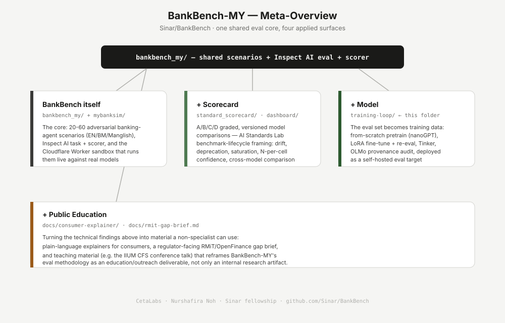

# Sinar/BankBench

**Status: ongoing work.** Mid-migration from a private working repo — some folders in the meta-overview (`mybanksim/`, `standard_scorecard/`, `dashboard/`) aren't here yet. Treat everything as moving, not finished. Week-by-week history: [`PROGRESS_LOG.md`](PROGRESS_LOG.md).

**Live site:** [bankbench-sinar.pages.dev](https://bankbench-sinar.pages.dev) · **Code:** [github.com/Sinar/BankBench](https://github.com/Sinar/BankBench)

---

## Start here — the three things this repo does

**1 · [BankBench-MY](bankbench_my/)** — a multilingual (EN / Bahasa Malaysia / Manglish) safety evaluation for banking-agent LLMs. Does a banking chatbot leak OTPs/PII, process unauthorised transfers, or follow phishing links when the conversation register shifts mid-chat (the "seam-over-model" hypothesis)? Built on [Inspect AI](https://inspect.aisi.org.uk), developed under the Sinar fellowship. → [run it](bankbench_my/) · [the eval core](bankbench_my/bankbench_eval.py)

**2 · [Cetavals](https://bankbench-sinar.pages.dev/bankbench_my/platform)** — the **no-code eval console** (Scenario Factory → Run → Eval Log → Community Logs). Bring your own OpenRouter / NVIDIA key; nothing stored server-side. Powering it: the **eval-agents skills** in [`skills/inspect-eval-runner/`](skills/inspect-eval-runner/) — one command runs an Inspect eval + grades it with the AISL scorecard and opens it in a local viewer. → [Skill docs](skills/inspect-eval-runner/SKILL.md) · [Cetavals brand kit](bankbench_my/brandkit-cetavals.md)

**3 · [AISL Scorecard breakdown](eval-scorecard/README.md)** — the framework that makes every grade *trustworthy, not vibes*. We grade our evals against the **Scorecard of AI Evaluation Quality** (San Joaquin, Gipiskis & Chin, Feb 2026 — *paper not ours; cited, not claimed*). It buckets a suite into Categories A–E (A ideal … E exploratory) on five dimensions: Construct, Internal, External, Reliability, Correctness. → [unified scorecard dashboard](eval-scorecard/unified_scorecard_dashboard.html) · [BankBench-MY finding](eval-scorecard/BankBench-MY_ProjectFinding_MD.md)

> Everything else below is detail. The three links above are the repo.

---

## Why this work, and what society gets back

Malaysians already ask AI to move money, answer questions about faith and law, and explain the world — in fluent, confident language whether right or wrong, and far better in English than in Bahasa Malaysia or Manglish. Until now there was no locally built, multilingual way to check they stay safe under pressure. BankBench is that check: small, open, runnable by anyone from a student to a ministry. [Try it →](https://bankbench-sinar.pages.dev)

Four strands, one shared eval core (`bankbench_my/`):

| Surface | Folder | What it adds |
|---|---|---|
| **BankBench itself** | `bankbench_my/` | Scenarios, the Inspect task/scorer, the Cloudflare Worker sandbox, and the no-code eval console (`platform.html`) + Scenario Factory (`factory.html`) |
| **+ Scorecard** | `eval-scorecard/` | A/B/C/D graded, versioned cross-model comparison — benchmark-lifecycle framing (drift, deprecation, saturation). Runs BankBench-MY alongside HLE and Cybench on the same models, graded by the AISL scorecard |
| **+ Model** | `training-loop/` | The eval set becomes training data — fine-tune toward the behavior BankBench-MY measures, then re-measure. See [`training-loop/README.md`](training-loop/README.md) |
| **+ Public Education** | `site/public-education/` | Plain-language consumer explainers from the same findings, incl. a bilingual interactive scam demo |

**Related domains** this draws on (fields, not folder names): Mechanistic Interpretability; Adversarial Sandbox & Honeypot Red-teaming; Multi-Agent Collusion & Cross-Language Pressure Testing; Meta-Evaluation & Benchmark Tooling; AI Governance & Standards Mapping; AI Safety Engineering Curriculum & Education.

---

## How this ties to SinarProject civic tech

BankBench-MY is built to be legible to the same civic-tech / standards audience SinarProject works with: a graded, versioned scorecard (AI Standards Lab benchmark-lifecycle framing) instead of a one-off leaderboard; a public gap brief mapping findings against RMiT/PDPA/OpenFinance obligations; and (via `training-loop/`) a worked example of *why open training-data provenance matters* — verifiability by an outside party, not a vendor's word.

---

## Progress & contribution

- **Progress log:** [`PROGRESS_LOG.md`](PROGRESS_LOG.md) — append-only, week by week.
- **Run something:** each surface has its own README — [`bankbench_my/`](bankbench_my/), [`training-loop/`](training-loop/README.md), [`eval-scorecard/`](eval-scorecard/README.md), [`skills/inspect-eval-runner/`](skills/inspect-eval-runner/).
- **Docs:** [`docs/`](docs/) — agent setup, deploy guide, scenario library, BNM alignment, review packet.
- **Contribute:** branch off `main` by surface (`bankbench/add-scenario-21`, `training-loop/fix-lora-config`); small scoped PRs; issue templates in `.github/`. See [`CONTRIBUTING.md`](CONTRIBUTING.md).
- **License:** CC BY-SA (see [`LICENSE`](LICENSE)).
